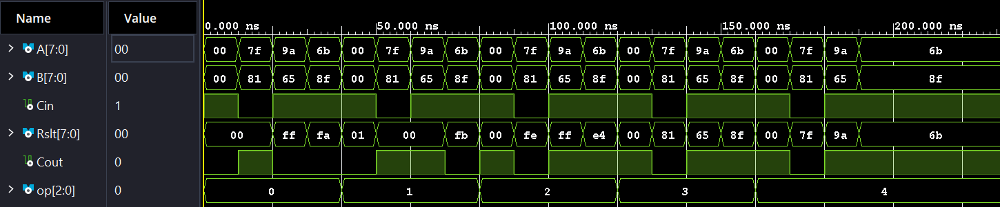
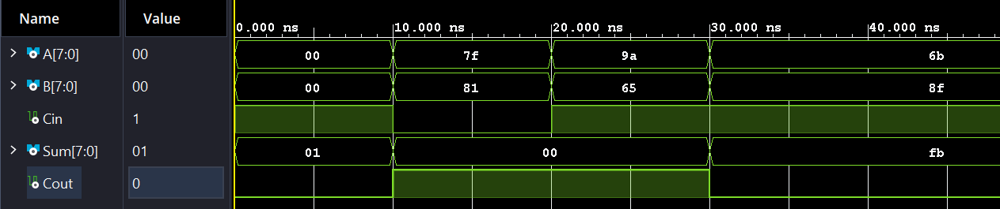

# 8-bit ALU in VHDL

An ECE 2700 project at Weber State University. The ALU combines an 8-bit
ripple-carry adder, XOR, and operand-selection logic.

## Operations

- `000`: A + B. Cin is ignored.
- `001`: A + B + Cin.
- `010`: A XOR B.
- `011`: pass B.
- `100` through `111`: pass A. The lab calls `100` hold, but this is pass-through
  logic, not a register storing an earlier value.

Cout is the unsigned carry for addition. Other operations pass Cin to Cout.
This coursework ALU has a different interface from the NZVC ALU in the benchmark repo.

## Run it

From Linux or WSL with Docker:

```bash
bash run_checks.sh
```

The testbenches check all **1,048,576** ALU input combinations and **131,072**
8-bit adder combinations. Expected sums use integer arithmetic rather than the
adder's carry wiring. An assertion failure stops the run. GitHub Actions runs
the same checks.

For Vivado 2024.2 or later, recreate the project from the sources. In PowerShell,
from this repository, substitute your installed Vivado path if needed:

```powershell
& 'C:\AMDDesignTools\2026.1\Vivado\bin\vivado.bat' -mode gui -source create_project.tcl
# Run both testbenches automatically:
& 'C:\AMDDesignTools\2026.1\Vivado\bin\vivado.bat' -mode batch -source verification/vivado.tcl
```

Generated projects stay in `.vivado-work/<Vivado version>/` so releases do not
share compiled simulation files. Use `ALU` as the synthesis top and `ALU_tb` or
`Adder_8b_tb` as the simulation top. Choose **Run All** to finish the checks.

The benches pass in Windows Vivado 2026.1, Vivado 2024.2.1, and GHDL 4.1.0.
These checks cover binary functional behavior, not routed timing or a board demo.
The sample part is an Artix-7; board pin constraints are not included.

## Waveforms

These captures show the original directed simulation. The assertions above provide
the exhaustive pass/fail checks.



