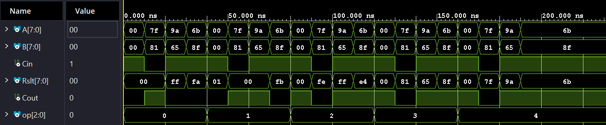
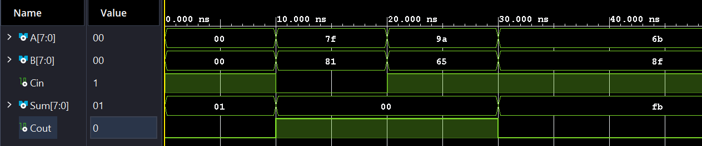

# 8-bit ALU in VHDL

An introductory digital-logic project from ECE 2700 at Weber State University.
The combinational ALU connects a reusable 8-bit ripple-carry adder to XOR and operand
selection logic. The saved project uses AMD/Xilinx Vivado 2026.1; the current exhaustive
benches also passed in Windows Vivado **2024.2.1** and GHDL **4.1.0** on October 29, 2026.

## Behavior

- `000`: A + B; external Cin is ignored.
- `001`: A + B + Cin.
- `010`: A XOR B.
- `011`: pass B (load operand).
- `100` through `111`: pass A. The original lab calls `100` hold; this is a
  combinational pass-through, not a register retaining state.
- Cout is the unsigned carry-out for the two addition operations; other operations
  pass Cin to Cout. This ALU does not produce signed-overflow or NZVC flags.

## Verification

Run from Linux or WSL with Docker Engine available:

```bash
bash run_checks.sh
```

The self-checking VHDL-2008 benches stop on an assertion failure. `Adder_8b_tb` checks
all 131,072 A/B/Cin combinations; `ALU_tb` checks all 1,048,576 A/B/Cin/op combinations.
Expected addition results use integer arithmetic, independently of the ripple-carry logic.
Checks establish binary functional behavior, not routed timing, physical FPGA operation,
or behavior for unknown/high-impedance inputs. Testbench assertions, Docker verification,
and documentation were expanded with AI assistance during a portfolio review.

## Vivado

For Vivado 2024.2 or later, recreate the project from portable sources rather than opening
a project saved by a newer release. From this repo in PowerShell, using your installed path:

```powershell
& 'C:\Xilinx\Vivado\2024.2\bin\vivado.bat' -mode gui -source create_project.tcl
# To run both testbenches automatically:
& 'C:\Xilinx\Vivado\2024.2\bin\vivado.bat' -mode batch -source verification/vivado.tcl
```

Generated files stay in ignored `.vivado-work/`. Select `ALU_tb` or `Adder_8b_tb` as
simulation top and choose **Run All**. `ALU` is the synthesis top. The sample target part
is an Artix-7 device; no board-specific pin constraints or on-board demonstration are supplied.
The original `Project 1.xpr` is also retained for compatible Vivado versions.

## Waveform examples

These are the original directed-stimulus Vivado captures; automated exhaustive checks
above provide the pass/fail evidence.




The design is intentionally small: it demonstrates component wiring, carry propagation,
combinational operation selection, and simulation verification.
